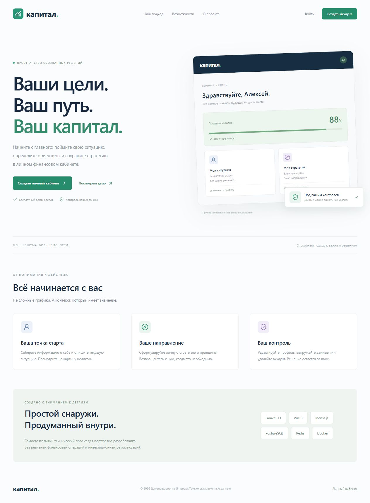
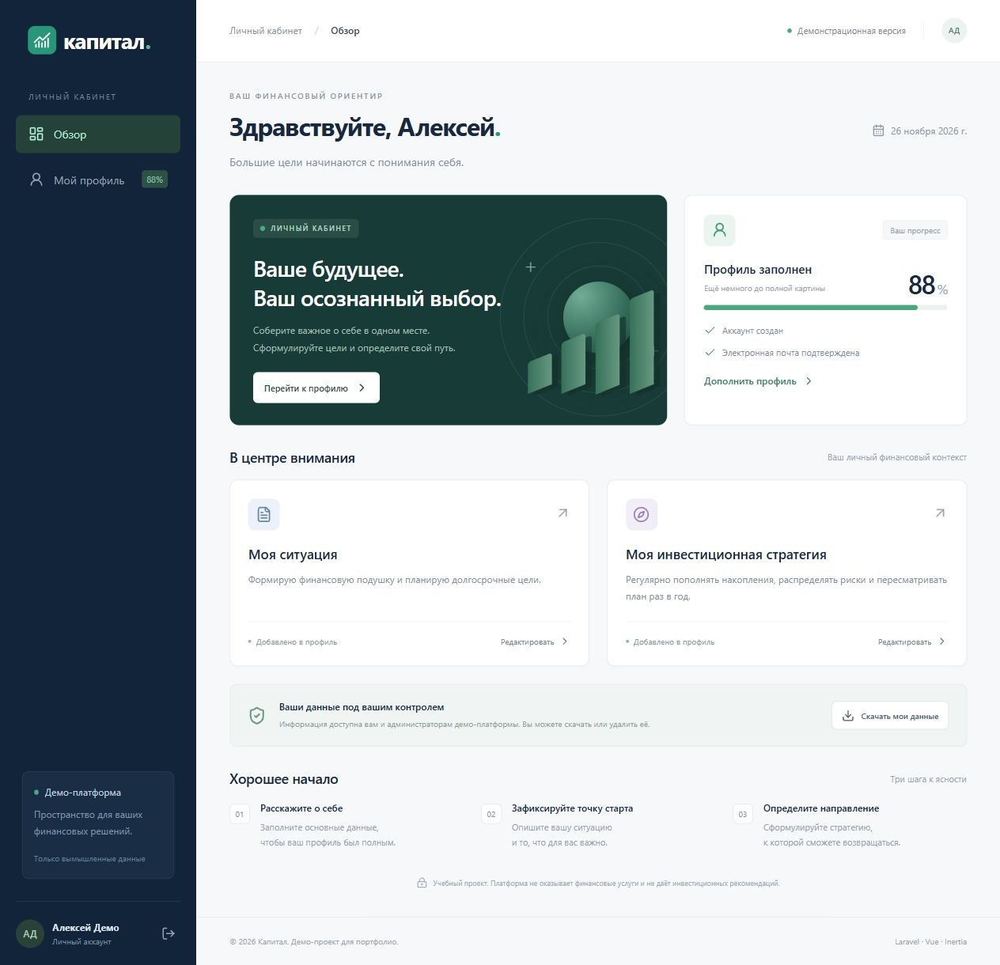
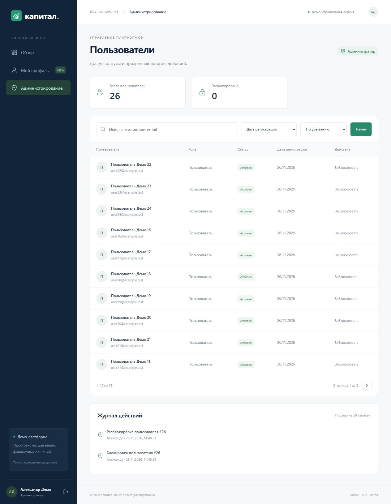
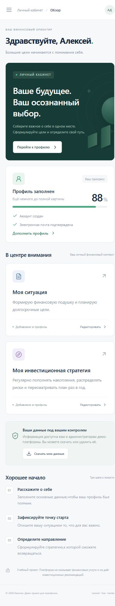

# Капитал · capital-platform-demo

Самостоятельный демонстрационный проект для портфолио разработчика на **Laravel + Vue**. Это технический пример личного кабинета, **не ранее выполненный коммерческий заказ** и не продукт финансовой организации.

Проект показывает серверную авторизацию, изоляцию данных, адаптивный интерфейс, автоматизированные тесты и подготовку к воспроизводимому локальному запуску. Все имена, контакты и тексты демонстрационных аккаунтов вымышлены. Реальных платежей, котировок и инвестиционных рекомендаций нет.

## Интерфейс

Скриншоты сняты с работающего приложения; изображения не сгенерированы и не являются макетами. Полные версии доступны по нажатию на изображение.

### Посадочная страница



### Личный кабинет



<details>
<summary>Административная панель и мобильная версия</summary>





</details>

## Стек

| Компонент | Версия / назначение |
| --- | --- |
| Laravel | 13.44.1, точная версия закреплена в composer.lock |
| PHP | 8.4+; Docker и CI используют 8.4 |
| Vue | 3.5+, Composition API |
| Inertia.js | 2, серверные страницы без отдельного публичного API |
| Vite | 7, сборка ресурсов |
| PostgreSQL | 17, основной контейнерный вариант |
| Redis | 7, сессии, кеш и rate limiting |
| Mailpit | Локальная почта для подтверждения email и восстановления |
| Docker Compose | Изолированный демонстрационный запуск |
| GitHub Actions | Проверки исходников, SQLite, PostgreSQL, Redis и Docker |

Laravel 13 поддерживает PHP 8.3, но данный lock-файл содержит Symfony 8 и требует PHP 8.4. Для npm-команд используйте Node.js 24 и npm. Зависимости PHP и JavaScript фиксируются lock-файлами. Теги базовых контейнеров отслеживают стабильные линии версий; сборка не заявляется побитово идентичной.

## Что реализовано

- Регистрация, вход, выход, подтверждение email и восстановление пароля.
- Кабинет и редактирование имени, фамилии, телефона, города и даты рождения.
- «Моя ситуация», «Моя инвестиционная стратегия», серверная заполненность профиля.
- Административный список: поиск, сортировка по разрешённым колонкам, пагинация.
- Серверное разграничение ролей, блокировка и разблокировка, журнал действий.
- Экспорт собственных данных в JSON и удаление аккаунта с проверкой текущего пароля.

Администратор видит email, имя, роль и статус пользователей. Список не отдаёт пароли, токены, телефон, дату рождения и личные текстовые блоки. Назначение администратора доступно только сидеру, через профиль изменить роль нельзя.

## Быстрый запуск: Docker

Нужны Docker Engine / Docker Desktop с Linux-контейнерами и Compose **2.20+**. Локальные PHP, Composer и Node.js не требуются. Порты 8000 и 8025 должны быть свободны.

Из корня свежего checkout в **PowerShell 7.2+**:

```powershell
./scripts/start-docker.ps1
```

Linux / macOS, при наличии OpenSSL:

```bash
sh scripts/start-docker.sh
```

Скрипт создаёт `.env` из примера, генерирует уникальные `DB_PASSWORD`, `DEMO_PASSWORD` и `APP_KEY`, собирает образ, ожидает сервисы, выполняет миграции и сидер. Секреты сохраняются только в исключённом `.env` и не выводятся в журнал. Существующие непустые значения сохраняются. SQLite-конфигурацию скрипт не перезаписывает; используйте отдельный checkout для Docker или предварительно подготовьте Docker `.env`.

- Приложение: [localhost:8000](http://localhost:8000).
- Просмотр писем: [Mailpit, localhost:8025](http://localhost:8025).
- Email пользователя: `demo@example.test`.
- Email администратора: `admin@example.test`.
- Пароль этих двух аккаунтов: локальное значение `DEMO_PASSWORD` из `.env`. Готового общего пароля в репозитории и JavaScript нет.

Кнопки выбора демо-аккаунта подставляют только email; пароль вводится вручную. Дополнительные 24 записи используют адреса `.test`, вымышленные имена и случайные неизвестные пароли. Повторный сидер восстанавливает профиль и пароль двух основных аккаунтов, поэтому не запускайте его для сохранения их ручных изменений. Сидер разрешён только при `APP_ENV=local` или `testing`, при пустом `DEMO_PASSWORD` он отказывает в запуске.

При регистрации откройте письмо в Mailpit и перейдите по ссылке. Восстановление пароля работает аналогично. Внешняя почта не отправляется.

### Управление контейнерами

```bash
docker compose ps
docker compose logs -f app
docker compose stop
docker compose up -d --wait
# Удаление контейнеров с сохранением базы и storage:
docker compose down
```

PostgreSQL и Redis не публикуют порты. Web-интерфейс и Mailpit привязаны к loopback. PostgreSQL и storage сохраняются в именованных томах; Redis используется как временное хранилище сессий и кеша. После пересоздания Redis может потребоваться повторный вход.

После изменения `.env` примените `docker compose up -d --force-recreate app`. Пустой `.env.example` нельзя использовать напрямую: `DB_PASSWORD` обязателен для Compose, а для запросов Laravel нужен `APP_KEY`.

### Безопасный запуск тестов в контейнере

```bash
docker compose exec -T -e DB_CONNECTION=sqlite -e DB_DATABASE=:memory: -e CACHE_STORE=array -e SESSION_DRIVER=array app php artisan test --testsuite=Unit,Feature
```

Тестовый базовый класс запрещает SQLite-файлы и серверные базы без суффикса `_test` до миграций. Это предотвращает случайный `migrate:fresh` на демонстрационной базе. Не запускайте функциональные тесты с параметрами реальной базы.

### Проверка PostgreSQL и Redis вручную

Используется отдельная одноразовая база:

```bash
docker compose exec -T postgres psql -U capital -d postgres -c 'CREATE DATABASE capital_test'
docker compose exec -T -e RUN_INFRA_TESTS=true -e DB_DATABASE=capital_test app php artisan test --testsuite=Integration
```

Повторно создавать существующую `capital_test` не нужно. При изменении `DB_USERNAME` используйте соответствующее имя в команде psql. В CI отдельная база и оба сервиса создаются автоматически.

## Локальная разработка без Docker

Нужны PHP 8.4 с mbstring, openssl, curl, fileinfo, PDO, pdo_sqlite, dom, xml, xmlwriter, tokenizer и zip, Composer 2, Node.js 24 и npm.

```bash
composer install
npm ci --ignore-scripts
cp .env.example .env
```

В PowerShell вместо `cp` можно использовать `Copy-Item`. Для SQLite измените `.env`:

```dotenv
APP_URL=http://127.0.0.1:8000
DB_CONNECTION=sqlite
DB_DATABASE=database/database.sqlite
SESSION_DRIVER=database
CACHE_STORE=database
MAIL_MAILER=log
```

Создайте файл `database/database.sqlite`, задайте в `.env` уникальный `DEMO_PASSWORD` не короче 16 символов. Например, сгенерируйте его через `openssl rand -hex 24`, сохраните локально и не публикуйте.

```bash
php artisan key:generate
php artisan migrate --seed
npm run build
php artisan serve --host=127.0.0.1 --port=8000
```

В PowerShell файл можно создать командой `New-Item database/database.sqlite -ItemType File`, в Bash: `touch database/database.sqlite`. Для локальных ссылок подтверждения почты смотрите `storage/logs/laravel.log`; логи и URL с токенами нельзя публиковать. Для SMTP используйте Mailpit.

CSP рассчитана на собранные ресурсы: основной проверяемый режим использует `npm run build`. Для Vite HMR потребуется отдельная локальная политика `connect-src` и `script-src`; ослабление политики в публикуемую конфигурацию не включено.

## Архитектура

Проект намеренно небольшой: без лишних репозиториев-обёрток и отдельного API для тех же страниц.

| Область | Ответственность |
| --- | --- |
| `routes/web.php` | Группы guest/auth, verified, auth.session и throttle |
| `AuthController` | Стандартные password broker и email verification Laravel, управление сессией |
| `ProfileController` | Собственный профиль через текущего пользователя, экспорт по белому списку, удаление |
| `UpdateProfileRequest` | Разрешение операции и серверные правила профиля |
| `AdminController` | Разрешённые запросы списка и транзакция блокировки с аудитом |
| `User` | Типы, хеширование пароля и заполненность |
| `EnsureActive` | Отзыв доступа заблокированным аккаунтам |
| `HandleInertiaRequests` | Белый список общих props без секретов |
| `SecurityHeaders` | CSP, no-store, запрет встраивания и защитные HTTP-заголовки |
| `resources/js/Pages` | Страницы Vue; общий адаптивный каркас в `Components/Shell.vue` |
| `database` | Миграции и явно вымышленные демо-данные |

Блокировка строки `FOR UPDATE` и запись в журнал находятся в одной транзакции PostgreSQL. Администраторов блокировать нельзя. Журнал хранит все действия, интерфейс показывает последние 50. После удаления администратора его ссылка в журнале становится `null`; технические идентификаторы событий сохраняются.

PHPDoc собственных классов и именованных методов написан на русском и проверяется скриптом. Комментарии к нетривиальным решениям написаны на русском. Стандартные пояснения Laravel в `config` сохранены из upstream; они не являются PHPDoc прикладных методов.

## Безопасность

- Проверки ролей выполняются на сервере для каждого административного обработчика.
- Профиль, экспорт и удаление работают через `$request->user()`, не через переданный `user_id`.
- Роль, блокировка, пароль и подтверждение email не входят в разрешённые поля редактирования профиля.
- Пароли хешируются bcrypt; при входе регенерируется сессия, при выходе она инвалидируется. `auth.session` сверяет хеш и отзывает старые сессии после смены пароля.
- Inertia шифрует клиентскую историю; при выходе и удалении запрашивается её очистка. Это не заменяет серверные права и HTTPS.
- Изменяющие запросы защищены CSRF. Vue выводит пользовательские тексты интерполяцией, без `v-html`. SQL-параметры связываются Eloquent, сортировка проходит белый список.
- Есть rate limiting для входа, регистрации, восстановления, повторных писем, экспорта, удаления и админских изменений. В Docker кеш ограничений размещается в Redis.
- `.gitignore`, `.dockerignore` и проверка публикации исключают окружения, базы, логи, приватные ключи, локальные инструменты и зависимости.

Правила изоляции проверяются HTTP-тестами с подменой идентификаторов, email и прав. Это прикладной аудит и регрессионные проверки, не независимый пентест и не гарантия отсутствия всех возможных уязвимостей.

Основания для используемых механизмов: [Laravel Authentication](https://laravel.com/framework/docs/13.x/authentication), [порядок запуска Docker Compose](https://docs.docker.com/compose/how-tos/startup-order), [service containers в GitHub Actions](https://docs.github.com/en/actions/tutorials/use-containerized-services).

## Проверки и CI

```bash
composer validate --strict
php scripts/check-publication.php
php scripts/check-phpdoc.php
vendor/bin/pint --test
php artisan test
npm run format:check
npm run build
composer audit
npm audit --audit-level=high
```

Локальный результат на SQLite: **28 пройденных тестов, 170 assertions; 1 тест инфраструктуры пропущен**. Инфраструктурный тест запускается только с `RUN_INFRA_TESTS=true` и проверяет PostgreSQL, Redis-кеш и Redis-сессии. Без доступных сервисов он не отмечается пройденным.

В PowerShell 7 при запущенном приложении и сидере можно выполнить `scripts/http-smoke.ps1`. Передайте `DEMO_PASSWORD` через окружение процесса из локального `.env`, не через командную строку или публикуемый файл. Скрипт проверяет реальный CSRF 419, вход с токеном, экспорт и административный 403.

Workflow `.github/workflows/ci.yml` содержит два задания:

1. Проверки кода, PHPDoc, публикации, сборки и форматирования, тесты SQLite, отдельный прогон на PostgreSQL/Redis, явные round-trip проверки Redis и аудит зависимостей.
2. Проверку Compose, сборку Dockerfile, миграции и сидер в контейнере, запросы к приложению и Mailpit и инфраструктурный тест.

У Actions минимальное право `contents: read`, заданы timeout, healthchecks и отмена устаревших запусков. Используемые actions закреплены SHA. Пароль PostgreSQL в CI относится только к одноразовому сервису тестового задания и не открывает доступ к рабочим ресурсам.

**Границы проверки:** локально выполнены тесты SQLite, сборка, проверки исходников и браузерная проверка. `compose config --quiet` проверен официальным standalone Compose 5.8.0. Docker Engine здесь отсутствует: образы не собирались, контейнеры, PostgreSQL, Redis и Mailpit локально не запускались. GitHub Actions до публикации не выполнялся. Полный отчёт: [docs/VERIFICATION.md](docs/VERIFICATION.md).

## Подготовка публичного репозитория

Рекомендуемое имя: **capital-platform-demo**. Это подготовка исходников; публичный репозиторий автоматически не создан. Порядок публикации и проверок описан в [docs/PUBLISHING.md](docs/PUBLISHING.md).

До отправки заказчику требуется дождаться зелёного первого CI, особенно задания Docker, и проверить письма в Mailpit на поднятом стенде. При внешнем размещении нужны HTTPS, `SESSION_SECURE_COOKIE=true`, отдельный веб-сервер вместо `artisan serve`, уникальные секреты и выключенные демо-аккаунты. Текущий Compose рассчитан на локальную демонстрацию, не на production-хостинг.
